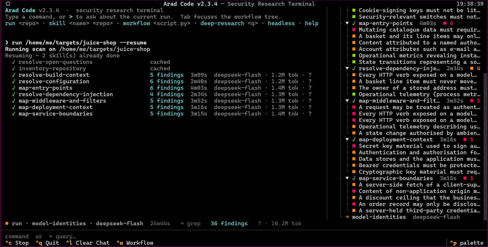

<div align="center">

# Arad Code

**A security code auditor that reads your codebase like a reviewer would,<br>and only reports what it can point to in the code.**


</div>

<p align="center">
  
</p>

Arad Code drives an LLM through a set of audit "skills" (plain markdown playbooks) against a repository. The model gets real tools: a code graph, ripgrep, an AST parser, semgrep, a read-only shell. It maps the project first (entry points, middleware, identities, ownership), then traces data and hunts for concrete vulnerability patterns.

Every finding goes through an evidence gate before it's allowed out. The engine re-reads the cited file, checks the quoted code is actually at those lines, caps confidence by how the evidence was gathered (a grep hit counts for less than a traced call chain), and keeps anything with unresolved proof obligations out of the report. What survives is something you can open in your editor and check.

## Contents

- [How a scan works](#how-a-scan-works)
- [Requirements](#requirements)
- [Installation](#installation)
- [Configuration](#configuration)
- [Quick start](#quick-start)
- [The terminal UI](#the-terminal-ui)
- [CLI reference](#cli-reference)
- [Reading the results](#reading-the-results)
- [Cost, budgets and transcripts](#cost-budgets-and-transcripts)
- [Project profile (.llmsast.yaml)](#project-profile-llmsastyaml)
- [Workflow scripts](#workflow-scripts)
- [Extra MCP servers](#extra-mcp-servers)
- [Writing your own skills](#writing-your-own-skills)
- [Where things are stored](#where-things-are-stored)
- [Troubleshooting](#troubleshooting)
- [Development](#development)

## How a scan works

Skills live in `skills/`, one folder per phase. A full run goes through them in order:

| Phase | What happens | Skills |
|---|---|---|
| `p0` | Resolve blocking open questions left by earlier skills. Runs before a phase only when something is actually blocked. | 1 |
| `p1` | Project understanding: inventory, build, config, entry points, DI, middleware, deployment, service boundaries | 8 |
| `p2` | Identity and ownership: identities, authorization model, resource ownership, tenants, state machines, invariants, trust boundaries, sensitive data | 8 |
| `p3` | Path analysis: input to effect, effect back to callers, identity propagation, persisted data reuse, cross-service messages | 6 |
| `p4` | Hunting: 17 `hunt-*` breadth scans (SQLi, SSRF, XSS, auth bypass, secrets, IaC, LLM/MCP issues and more) plus 9 deep-dive reviews | 26 |
| `p5` | Compose individual findings into attack chains | 1 |

Earlier phases write what they learn (a threat model, entry points, guards, function summaries) into a local SQLite store, and later phases start from that context instead of rediscovering it.

`p1` and `p2` run one skill at a time because each builds on the one before. The `p3` and `p4` skills don't depend on each other, so up to three of them run at once (`--concurrency` changes that).

Before a run starts, Arad Code takes a quick look at the repository without calling the model: file types, dependency manifests (`package.json`, `requirements.txt`, `go.mod`, `pom.xml` and the like) and a few telltale lines of code. Skills that can't apply are skipped. A command line tool with no HTML, no templates and no web framework doesn't get the XSS or open redirect hunts, a repo without Docker, Terraform or CI files doesn't get the IaC hunt, and so on. Each skip is printed with its reason and recorded in `coverage`. The check only skips when nothing points the other way, and when it can't finish looking (a huge repository), it skips nothing. `--all-skills` turns it off for one run, `skill_gating: false` for good.

Each finding is a hypothesis with an actor, an entry point, an execution path, the invariant it breaks and the impact. Its status moves like this:

```
initial --> evidence_supported --> human_confirmed     (you accept it in triage)
   |               |
   |               +--> refuted / rejected             (verification or triage says no)
   |
   +--> stays initial while proof obligations are unresolved, a blocking
        question is open, or the evidence is only textual
```

Only `evidence_supported`, `reproduced` and `human_confirmed` findings are exported to SARIF.

## Requirements

- Python 3.10 or newer. 3.10, 3.11, 3.12, 3.13 and 3.14 are all tested. The 3.15 betas don't work yet because PyYAML has no build for them.
- An OpenAI compatible chat completions endpoint with tool calling. OpenAI, OpenRouter and self-hosted gateways that speak the same API all work.
- `git` and [ripgrep](https://github.com/BurntSushi/ripgrep) (`rg`). The grep tool depends on ripgrep's regex syntax.
- Recommended: [codebase-memory-mcp](https://github.com/DeusData/codebase-memory-mcp) for the code graph (`search_graph`, `trace_path`, `get_code_snippet`). Without it the agent falls back to grep and reads more files by hand.
- Optional: `semgrep`, `jq`, `tree`, `file`.

## Installation

```bash
git clone https://github.com/fedman0/Arad-Code.git
cd Arad-Code
./install.sh
```

`install.sh` creates a virtualenv in `.venv`, installs the Python packages, installs ripgrep and the other system tools with your package manager (apt, dnf, pacman, apk or Homebrew), installs semgrep in its own environment, and downloads the tree-sitter grammars so the first scan doesn't need the network.

| Flag | Effect |
|---|---|
| `--tier core` | Only what the engine needs to run |
| `--tier recommended` | Core plus the shell tools and codebase-memory-mcp (default) |
| `--tier all` | Everything, including language servers, secret scanners and benchmark repos |
| `--check` | Verify what's installed, change nothing |
| `--dry-run` | Print the commands without running them |
| `--no-venv` | Install Python packages into the current environment |

You can move things around with `LLMSAST_VENV`, `LLMSAST_BIN` (default `~/.local/bin`), `LLMSAST_SEMGREP_VENV` and `LLMSAST_BENCH`.

Prefer doing it by hand:

```bash
python3 -m venv .venv
.venv/bin/pip install -r requirements.txt
```

and install `ripgrep` from your package manager. The minimum versions in `requirements.txt` are the oldest ones the test suite passes with; anything newer, up to the current releases, works too. semgrep is intentionally not in `requirements.txt`; its pinned dependencies fight with the rest, so give it its own environment (`pipx install semgrep` is the easy way).

If you'd rather have it as a normal command, install the checkout with pipx (or `uv tool install .`):

```bash
pipx install .
arad --version
arad --headless list-skills
```

That gives you an `arad` command on your `PATH` with the skills bundled in, and it takes the same subcommands as `python pentest.py`. ripgrep and codebase-memory-mcp still come from your system, so install those separately.

## Configuration

The fastest way is the interactive setup:

```bash
python pentest.py --headless config-init
```

It asks for the endpoint, key, model and the codebase-memory-mcp binary, keeps whatever else is already in the file, and writes `~/.pentest/config.yaml` with `0600` permissions.

### The config file

Settings are read from the first file that exists:

1. the file passed with `--config` (it's an error if that file doesn't exist)
2. `./config.yaml` in the directory you run from
3. `~/.pentest/config.yaml`

A complete example:

```yaml
model: gpt-5.5
api_base: https://api.openai.com/v1
api_key: sk-your-key

mcp_server: codebase-memory-mcp
mcp_args: []

db_path: ~/.pentest/evidence.db
skills_dir: ""

max_tokens: 8192
temperature: 0.0
reasoning_effort: ""

profile_path: ~/audit-profiles/acme-shop.yaml
trust_repo_profile: false

mcp_allow:
  github: [get_file_contents]

max_retries: 4
budget_usd: 5
transcripts: true

pricing:
  gpt-5.5:
    input: 1.25
    cached_input: 0.125
    output: 10
```

The prices above only show the shape. Copy the real numbers from your provider's price list; they're in US dollars per million tokens.

| Key | Default | What it does |
|---|---|---|
| `model` | `gpt-5.5` | Model name sent to the endpoint |
| `api_base` | `https://api.openai.com/v1` | Base URL of the OpenAI compatible API |
| `api_key` | none | Required for anything that talks to the model |
| `mcp_server` | `codebase-memory-mcp` | Binary started for the code graph (looked up on `PATH`) |
| `mcp_args` | `[]` | Extra arguments for that binary |
| `db_path` | `~/.pentest/evidence.db` | SQLite evidence store, shared by every repo you scan |
| `skills_dir` | empty | Use a different skills folder. Empty means `./skills` next to `pentest.py` |
| `max_tokens` | `8192` | Max tokens per model reply |
| `temperature` | `0.0` | Sampling temperature |
| `reasoning_effort` | empty | `low`, `medium` or `high` for reasoning models. Sent as `reasoning.effort` to OpenRouter and as `reasoning_effort` everywhere else |
| `profile_path` | empty | Path to a project profile kept outside the target repo (see below) |
| `trust_repo_profile` | `false` | Allow a `.llmsast.yaml` committed inside the target repo to be loaded |
| `mcp_allow` | `{}` | Per server list of non read-only MCP tools you explicitly allow (see [Extra MCP servers](#extra-mcp-servers)) |
| `max_retries` | `4` | How many times a rate limited or failed request is retried before the skill gives up |
| `pricing` | `{}` | Price per million tokens for each model: `input`, `output` and optionally `cached_input`. Used to show costs and to enforce `budget_usd` |
| `budget_usd` | none | Stop once spend reaches this many dollars (see [Cost, budgets and transcripts](#cost-budgets-and-transcripts)) |
| `token_budget` | none | Stop once this many tokens have been used |
| `transcripts` | `true` | Save every conversation with the model as JSON lines |
| `transcripts_dir` | empty | Where to save them. Empty means a `transcripts` folder next to `db_path` |
| `fast_model` | empty | Cheaper model for the `p1` mapping skills. Empty means `model` (see [Using more than one model](#using-more-than-one-model)) |
| `verify_model` | empty | Model for `verify`. Empty means `model` |
| `concurrency` | `3` | How many `p3`/`p4` skills may run at the same time. `1` runs everything in order |
| `context_char_limit` | `200000` | Once a skill's conversation grows past this many characters, older tool output is shortened. `0` keeps everything |
| `skill_gating` | `true` | Skip skills that don't apply to the project's stack |

### Environment variables

These override the file, and command line flags override both:

| Variable | Same as |
|---|---|
| `PENTEST_API_KEY` | `api_key` / `--api-key` |
| `PENTEST_API_BASE` | `api_base` / `--api-base` |
| `PENTEST_MODEL` | `model` / `--model` |
| `PENTEST_REASONING_EFFORT` | `reasoning_effort` |
| `PENTEST_FAST_MODEL` | `fast_model` / `--fast-model` |
| `PENTEST_VERIFY_MODEL` | `verify_model` / `--verify-model` |

Example with OpenRouter:

```bash
export PENTEST_API_BASE=https://openrouter.ai/api/v1
export PENTEST_API_KEY=sk-or-...
export PENTEST_MODEL=openai/gpt-5.5
```

### Using more than one model

Out of the box everything runs on the one model you set in `model`, and that's a fine way to use it. If you want to bring the cost down, two optional settings let you split the work:

```yaml
model: gpt-5.5
fast_model: gpt-5.4-mini
verify_model: gpt-5.4
```

- `fast_model` runs the `p1` skills (inventory, build, config, entry points, DI, middleware, deployment, services). That work is mostly reading files and writing down what's there, so a smaller model handles it well. Everything after `p1` still uses `model`.
- `verify_model` is used by `verify`. Checking a finding with a different model than the one that reported it catches more mistakes than asking the same model twice.

Which skills count as "fast" is set in each skill's header (`tier: fast`, see [Writing your own skills](#writing-your-own-skills)). Every model in use needs to be reachable through the same `api_base`, so on OpenRouter you can mix vendors freely. The usage table, `usage` command and TUI always show which model did what.

## Quick start

```bash
python pentest.py --headless init ~/src/acme-shop
python pentest.py run ~/src/acme-shop
python pentest.py --headless report ~/src/acme-shop --md > report.md
python pentest.py --headless sarif ~/src/acme-shop --output-dir out/
```

1. `init` indexes the repo with codebase-memory-mcp and registers it in the evidence store. Run it again after big changes so the graph is fresh.
2. `run` opens the terminal UI and starts a full scan. A full scan is a few dozen skills, so expect it to take a while and spend real tokens. Ctrl+C stops it, and finished skills are kept.
3. `report --md` writes a Markdown report, deduplicated and sorted by priority.
4. `sarif` writes `out/findings.sarif` for GitHub code scanning or any other SARIF viewer.

To scan only part of the pipeline, pass a phase: `--phase p4` (or just `--phase 4`). To run a single skill: `python pentest.py skill hunt-ssrf ~/src/acme-shop`.

## The terminal UI

```bash
python arad.py
```

`python pentest.py` with no arguments does the same thing. Starting it with `run`, `skill`, `workflow` or `deep-research` launches the UI with that command already running, for example `python pentest.py run ~/src/acme-shop --phase p1`.

Commands typed into the UI:

| Command | Description |
|---|---|
| `run <repo> [--phase N] [--resume] [--restart] [--all-skills]` | Full scan, or one phase |
| `skill <name> <repo> [context]` | One skill. Anything after the repo is passed to the skill as extra context |
| `workflow <script.py> [--repo <path>]` | Run a workflow script (see [Workflow scripts](#workflow-scripts)) |
| `deep-research <question> [--repo <path>]` | Open ended research: past bug classes, attack surface, grep leads, priority files |
| `report`, `peers`, `coverage`, `sarif`, `doctor`, `calibrate`, `reconcile`, `verify`, `init`, `list-skills` | Passed straight to the CLI, run in your current directory |
| `query <repo> "<expression>"` | Query the evidence store (quote the expression) |
| `headless` | Leave the UI and continue in the plain CLI |
| `usage <repo>` | Tokens and cost of recent runs, passed to the CLI like `report` |
| `help`, `clear`, `exit` | |

`triage`, `config-init` and `query` without an expression ask questions interactively, so run those from the plain CLI.

Start a line with `>` to ask the model about the current or last run while it's going, for example `> which finding should I look at first?`. Two shortcuts don't call the model at all: `> status` and `> findings`.

| Key | Action |
|---|---|
| `Ctrl+C` | Stop the running task |
| `Ctrl+W` | Show or hide the workflow panel |
| `Tab` | Jump into the workflow tree, `Tab` or `Esc` to get back |
| `Enter` (in the tree) | Open a phase, skill or finding in detail |
| `Ctrl+L` | Clear the model's answers, keep the scan output |
| `End` | Follow new output again after you scrolled up |
| `↑` `↓` | Command history |
| `Ctrl+Q` | Quit |

The workflow tree shows which model ran each skill, and the line logged when a skill finishes has its model, token count and cost. The status bar keeps a running total for the session. Opening a skill in the tree shows its calls and tokens in detail, and opening a finding shows the model that reported it and, once you've run `verify`, the model that checked it.

While a command runs, new commands are queued and start one after another. `help`, `clear`, `exit` and `>` questions run immediately. Persian and other right-to-left text in model answers is shaped and reordered so it reads correctly in the terminal.

## CLI reference

Everything is a subcommand of `pentest.py`. `run` and `skill` open the UI unless you add `--headless`. `workflow` and `deep-research` only exist inside the UI. Every other command prints straight to the terminal.

Commands that call the model accept `--api-key`, `--api-base`, `--model` and `--config`. Commands that only read the store take `--config` and work without a key.

### Scanning

```
pentest.py init REPO
pentest.py run REPO [--phase P] [--resume] [--restart] [-N] [-v] [--concurrency N] [--all-skills]
                     [--fast-model M] [BUDGET OPTIONS]
pentest.py skill SKILL REPO [--context TEXT] [-N] [--fast-model M] [BUDGET OPTIONS]
pentest.py verify HYPOTHESIS_ID REPO [--verify-model M] [BUDGET OPTIONS]
pentest.py list-skills
```

- `--resume` skips skills already finished at the current commit. If a run was interrupted and you start it again without a flag, you'll be asked whether to resume.
- `--restart` throws away saved progress and starts over.
- `-N` / `--negative-evidence` makes the `p3` and `p4` skills also record *why* an entry point is safe: the exact guard line that protects it. Those anchors are re-checked on later runs, and if the guard disappears from the code the entry point is flagged for review again.
- `-v` prints every tool call as it happens.
- `--concurrency N` sets how many `p3`/`p4` skills run at once (default 3). Raise it if your API key has the rate limit for it; `1` runs one skill at a time.
- `--all-skills` runs every skill, including the ones the stack check would skip.
- `--fast-model` and `--verify-model` override `fast_model` and `verify_model` for one command.
- `verify` sends one finding to an adversarial pass whose only job is to refute it, then updates its status. Your own triage decisions are never overwritten.
- Budget options: `--budget USD`, `--token-budget N` and `--no-transcripts`, explained in [Cost, budgets and transcripts](#cost-budgets-and-transcripts).

### Results

```
pentest.py report REPO [--min-severity N] [--min-confidence N] [--status S] [--md]
pentest.py sarif REPO [--output-dir DIR]
pentest.py query REPO [EXPRESSION]
pentest.py coverage REPO [--show STATUS]
pentest.py triage REPO [--min-priority N] [--all]
pentest.py calibrate [REPO] [--min-samples N]
pentest.py peers REPO [--save/--no-save]
pentest.py reconcile REPO
pentest.py doctor REPO
pentest.py usage REPO [--run ID] [--limit N]
pentest.py config-init [--path FILE]
```

| Command | What it's for |
|---|---|
| `report` | Table of findings. `--md` prints a full Markdown report with evidence snippets |
| `sarif` | SARIF 2.1.0 file. Includes the commit and the repo URL (taken from `origin`, credentials stripped) |
| `query` | Small query language over the store, see below. Without an expression it opens a prompt |
| `coverage` | What was analysed and, more usefully, what wasn't |
| `triage` | Walk findings by priority and answer `a` accept, `r` reject, `n` need info, `s` skip |
| `calibrate` | Compares the confidence the model claimed with what you accepted in triage |
| `peers` | Finds routes missing a protection that nearly all their siblings have. Needs `p1` to have run |
| `reconcile` | Re-checks every evidence anchor against the current code and recomputes statuses, no model calls |
| `doctor` | Explains why nothing (or little) is being exported |
| `usage` | Tokens, cost and models of recent runs; `--run ID` breaks one run down by step |

### Query language

```bash
python pentest.py --headless query ~/src/acme-shop "hypotheses where exposure=internet and status=evidence_supported"
python pentest.py --headless query ~/src/acme-shop "entry_points where auth=none"
python pentest.py --headless query ~/src/acme-shop "coverage where status=blocked"
python pentest.py --headless query ~/src/acme-shop "why 3fa94c1e"
```

| Collection | Filters |
|---|---|
| `hypotheses` | `status`, `exposure`, `reachability`, `input_control`, `guard_coverage`, `severity`, `confidence` |
| `entry_points` | `auth=none`, `auth=<decorator name>`, `kind` (`route`, `consumer`, `job`, `command`, `hook`, `callback`) |
| `coverage` | `status`, `kind` |
| `why <id>` | Everything about one finding: path, evidence, obligations, counterevidence, triage decision |

Join filters with `and`.

## Reading the results

| Status | Meaning |
|---|---|
| `initial` | Found, but not proven enough to export |
| `evidence_supported` | Passed the evidence gate |
| `reproduced` | Confirmed by a runtime check |
| `human_confirmed` | You accepted it in triage |
| `refuted` / `rejected` | Disproved by verification, by the model with a recorded reason, by you, or suppressed by the profile |
| `blocked` | Can't be decided with what's available |
| `needs_recheck` | You confirmed it, but all of its evidence has since gone stale |

Severity is an integer from 0 to 10: 9 and 10 are critical, 7 and 8 high, 4 to 6 medium, 1 to 3 low, 0 informational. Confidence is capped by how the evidence was gathered: 4 for grep or plain file reads, 7 for structural tools (AST, symbol search), 10 only when a call chain was actually traced.

When a finding you expected isn't in the report, `doctor` and `query REPO "why <id>"` will usually tell you which obligation, open question or stale anchor is holding it back.

## Cost, budgets and transcripts

Every call to the model is metered: input tokens, how many of those the provider served from its prompt cache, output and reasoning tokens, time and cost. `run`, `skill` and `verify` end with a table that breaks this down by step and model, and the numbers are kept in the evidence store:

```bash
python pentest.py --headless usage ~/src/acme-shop
python pentest.py --headless usage ~/src/acme-shop --run 20261020-143502-9f3a1c
```

The first lists recent runs, the second shows one run step by step.

Costs come from the `pricing` table in your config. On OpenRouter the provider reports what each call cost, so you don't need the table there. A model with no known price shows `?` instead of a dollar amount; its token counts are still exact.

**Budgets.** `--budget 5` (dollars) or `--token-budget 2000000` stops the run before the next model call once the limit is reached. A call that's already in flight is allowed to finish, so the total can end up slightly over. Finished skills are kept, so after raising the limit `--resume` carries on from where it stopped. A run stopped this way exits with status 3. A dollar budget needs a price for every model in use; without one the command refuses to start rather than run unmetered. Both can also be set in the config as `budget_usd` and `token_budget`.

**Transcripts.** Each skill's whole conversation with the model (the prompt, every tool call and its result, the final answer, and the usage) is saved as JSON lines under `transcripts/<repo>/<run id>/`, next to the evidence store. When a finding looks wrong, that file shows how the model got there. The files are only readable by you, but they do contain source code from the scanned repo and whatever the model found in it, secrets included. `--no-transcripts` or `transcripts: false` turns them off.

**Long conversations.** A skill can make dozens of tool calls, and every call sends the whole conversation again, so cost grows quickly with length. Once a conversation passes `context_char_limit` characters, tool output older than the last six results is cut down to its first lines, with a note telling the model it can run the tool again for the rest. This happens in steps rather than on every call, so the provider's prompt cache keeps working. The evidence checks and the saved transcripts always use the full, untrimmed output.

**Models that refuse a parameter.** Some newer models don't accept a custom `temperature`, or want `max_completion_tokens` instead of `max_tokens`. When the endpoint rejects one of those, the client retries without it (or under the other name) and remembers that for the rest of the run, so the same config works across models.

## Project profile (.llmsast.yaml)

A profile tells the scanner things about your project it can't safely guess: which decorators count as authentication, which functions are real sanitizers, which paths are internal, and which known risks you've accepted.

```yaml
auth_markers:
  decorators: ["@login_required", "@requires_scope"]
  middleware: ["AuthMiddleware"]

sanitizers:
  - qn: app.security.escape_html
    neutralizes: [CWE-79]
    complete: true

trusted_sources:
  - values read from the internal settings service

exposure_overrides:
  "/admin/*": admin_only
  "/internal": internal
  "healthz": unreachable

suppress:
  - rule: CWE-89
    path: "migrations/**"
    reason: Migrations run offline by the DBA and never see request data
    expires: 2027-03-31
```

Some rules worth knowing:

- A profile can hide findings, so a `.llmsast.yaml` inside the repo you're scanning is **ignored by default**. Keep the profile outside the repo and point `profile_path` at it, or set `trust_repo_profile: true` if you trust the repo.
- Every suppression needs a `reason` and an `expires` date (`YYYY-MM-DD`). Expired ones stop applying, and the scan prompt says so. `rule: "*"` together with a `**` path is refused.
- `rule` is `*`, a CWE id, or a few words that must all appear in the finding.
- `exposure_overrides` match the route path, segment by segment. `/internal` covers `/internal` and `/internal/...` but not `/internals`. A pattern without a leading `/` can match at any segment.
- Allowed exposures: `internet`, `authenticated`, `internal`, `admin_only`, `unreachable`. An `unreachable` override keeps findings on that route out of the report.

## Workflow scripts

For audits the built-in phases don't cover, write a small Python script and run it from the UI with `workflow audit.py --repo ~/src/acme-shop`. These names are available inside the script without importing anything:

| Name | Use |
|---|---|
| `await phase(name, title=..., detail=...)` | Start a new phase in the workflow tree |
| `await agent(prompt, label=..., phase=..., schema=..., extra_context=...)` | One model run with the read-only tools. With a JSON `schema` you get a dict back |
| `await parallel([lambda: agent(...), ...], concurrency=10)` | Run several agents at once |
| `await pipeline(items, step1, step2, concurrency=10)` | Push items through async steps. A step can return a list to fan out, or `None` to drop the item |
| `await verify_finding(finding)` | Three adversarial votes. Returns the finding with `confirmed` set to `True`, `False` or `None` |
| `await submit_finding(hypothesis, evidence)` | Store a finding through the same evidence gate as the skills |
| `args` | Whatever was passed to the script (`None` from the UI) |

The script can define `run()` (sync or async). If its return value has a `findings` list, the UI prints how many were confirmed.

```python
SURFACE = {
    "type": "object",
    "properties": {
        "handlers": {
            "type": "array",
            "items": {
                "type": "object",
                "properties": {
                    "file": {"type": "string"},
                    "line": {"type": "integer"},
                    "function": {"type": "string"},
                    "code": {"type": "string"},
                },
                "required": ["file", "line", "function", "code"],
            },
        }
    },
    "required": ["handlers"],
}


async def run():
    await phase("map", title="Upload handlers")
    surface = await agent(
        "Find every HTTP handler that writes an uploaded file to disk. "
        "For each one give the file, the line where the path is built, the function name "
        "and that line of code copied exactly.",
        schema=SURFACE,
    )

    await phase("Verify", title="Verify")
    findings = []
    for h in surface.get("handlers", []):
        finding = {
            "id": h["function"],
            "claim": f"{h['function']} joins the client file name into the storage path without normalising it",
            "location": f"{h['file']}:{h['line']}",
        }
        verdict = await verify_finding(finding)
        findings.append(verdict)
        if verdict.get("confirmed"):
            await submit_finding(
                {
                    "actor": "unauthenticated user",
                    "capability": "upload a file with a crafted name",
                    "entry_point": f"{h['file']}:{h['function']}",
                    "security_boundary": "HTTP request",
                    "violated_invariant": "uploaded file name joined to the storage path without normalising",
                    "observable_impact": "files written outside the upload directory",
                    "severity": 8,
                    "confidence": 7,
                    "cwe": "CWE-22",
                    "reachability": "proven",
                    "input_control": "full",
                    "guard_coverage": "no_paths",
                    "exposure": "internet",
                },
                [
                    {
                        "kind": "code",
                        "description": "client controlled name used in the path",
                        "file_path": h["file"],
                        "line_start": h["line"],
                        "line_end": h["line"],
                        "snippet": "",
                        "anchor_text": h["code"].strip(),
                        "analysis_quality": {"method": "structural"},
                    }
                ],
            )
    return {"findings": findings}
```

`anchor_text` has to be copied from the cited lines (at least 12 characters), because the engine re-reads the file to check it. Evidence sent from a workflow counts as structural at most.

## Extra MCP servers

Workflow scripts and `deep-research` can also use the MCP servers listed under `mcpServers` in `~/.claude.json` (`stdio`, `sse` or `http` transport). They show up to the model as `mcp__<server>__<tool>`.

Only read-only tools are offered: tools the server marks with `readOnlyHint`, or whose names start with `read_`, `list_`, `get_`, `search_`, `grep_`, `query_`, `describe_`, `show_`, `fetch_`, `find_` or `check_`. Anything else has to be listed explicitly in `mcp_allow` in your config, and a tool that wasn't offered can't be called.

## Writing your own skills

A skill is one markdown file in a phase folder. The file name is the skill name:

```
skills/
  p4/
    hunt-graphql-introspection.md
```

```bash
python pentest.py --headless list-skills
python pentest.py --headless skill hunt-graphql-introspection ~/src/acme-shop
```

Skills whose names start with `hunt-` run in breadth mode: short checks, many patterns, and a strict output format the engine already explains to the model. Every other skill runs in deep mode with the full analysis rules. Look at an existing skill in the same phase before writing one; they all follow the same layout (trigger, inputs, steps, what to submit).

Things that keep a skill working:

- Write grep patterns in ripgrep's syntax exactly as `rg` should receive them: `\.execute\(`, not `\\.execute\\(`. No lookarounds. Use `multiline=true` when the pattern contains `\n`.
- The tools are `search_graph`, `trace_path` (`direction="inbound"` for callers, `"outbound"` for callees), `get_code_snippet`, `search_code` (literal unless `regex=true`), `read_file`, `list_dir`, `grep`, `parse_file_structure`, `find_all_usages`, `run_semgrep` (a pattern needs a `language`) and `shell`.
- `shell` runs one read-only command at a time with no pipes: `git log/show/blame/diff/ls-files/ls-tree/rev-parse/status/shortlog/describe/grep`, `find` (tests only, no `-exec` or `-delete`), `tree`, `wc`, `head`, `tail`, `file`, `stat`, `sha256sum`, `sha1sum`, `md5sum`, `jq`, `diff`, `strings`, `cut`. Paths have to stay inside the repo.
- Valid `exposure` values are `internet`, `authenticated`, `internal`, `admin_only` and `unreachable`. Anything else gets reset to `unspecified`.

A skill file can start with a short YAML header:

```markdown
---
order: 35
tier: fast
parallel: true
requires: [web, multiservice]
---

# SKILL: map-graphql-schema
```

| Key | Default | Meaning |
|---|---|---|
| `order` | `100` | Where the skill runs inside its phase. Lower goes first; equal numbers run in alphabetical order. The built-in `p1` and `p2` skills use 10, 20, 30 and so on, which leaves room in between |
| `tier` | `main` | `fast` runs the skill on `fast_model` when one is set |
| `parallel` | `false` | The skill doesn't depend on others in its phase and may run alongside them |
| `requires` | none | Skip the skill unless the project shows at least one of these: `web`, `templates`, `iac`, `llm`, `messaging`, `multiservice`, `ldap`, `multitenant` |

The header is stripped before the skill text goes to the model. A header that doesn't parse stops the run with the file name in the error, instead of being sent along as text.

## Where things are stored

| What | Where |
|---|---|
| Config | `~/.pentest/config.yaml` |
| Evidence store | `~/.pentest/evidence.db` (`db_path`) |
| Resume state and profile cache | `$XDG_CACHE_HOME/pentest`, usually `~/.cache/pentest` |
| Model conversations | `transcripts/` next to the evidence store (`transcripts_dir`) |
| tree-sitter grammars | `~/.cache/tree-sitter-language-pack` |
| Code graph | managed by codebase-memory-mcp |

Nothing is written into the repository you scan.

## Troubleshooting

**`api_key is required`**
Set `PENTEST_API_KEY`, run `config-init`, or pass `--api-key`.

**grep tool errors, or `multiline search requires ripgrep`**
ripgrep isn't on `PATH`. Install it (`apt install ripgrep`, `brew install ripgrep`, ...). Without it the tool falls back to GNU grep, which doesn't understand most skill patterns.

**Graph tools return nothing**
codebase-memory-mcp isn't installed or the repo isn't indexed. Run `pentest.py --headless init <repo>`. `install.sh --check` tells you whether the binary is on `PATH`.

**The scan runs but nothing is exported**
Run `doctor`. The usual reasons are unresolved proof obligations, a blocking open question, or evidence that's only textual. `query <repo> "why <id>"` shows the details for one finding.

**Symbol parsing is slow the first time on an offline machine**
tree-sitter grammars are downloaded on first use. Without network the parser gives up after 20 seconds and falls back to a simpler parser. Run `install.sh` once while online to pre-download them.

**`triage` does nothing inside the UI**
It's interactive. Type `headless`, or run `python pentest.py --headless triage <repo>`.

## Development

```bash
pip install -r requirements.txt pytest
python -m pytest
```

None of the tests need an API key or network access; the model is replaced by scripted fakes and the TUI is driven through Textual's test pilot. `tests/test_audit_regressions.py` can also be run directly as a script, and it prints one line per check.

The engine lives in `core/`:

| File | What's in it |
|---|---|
| `runner.py` | the agent loop for skills, verification and workflow prompts |
| `tool_exec.py` | the tools the model can call |
| `intake.py`, `evidence_gate.py` | turning the model's report into hypotheses, and the gate that decides what gets exported |
| `reconcile.py` | re-checking stored evidence against the current code |
| `prompts.py`, `tool_specs.py` | system prompts, output contracts and tool definitions |
| `skills.py` | loading skill files and their headers |
| `db.py` | the SQLite evidence store |

Changes to the evidence store's schema go in as numbered migrations in `db.py`. The database remembers which version it's at (`PRAGMA user_version`), so an older database is upgraded in place the first time a new release opens it, and a database written by a newer release is refused instead of being damaged.

Every push to `main` runs the suite on GitHub Actions: Python 3.10 to 3.14 on Ubuntu, 3.14 on macOS, once more with every dependency pinned to the oldest version `requirements.txt` allows, and a last job that builds the wheel, installs it into a clean virtualenv and runs the `arad` command.
